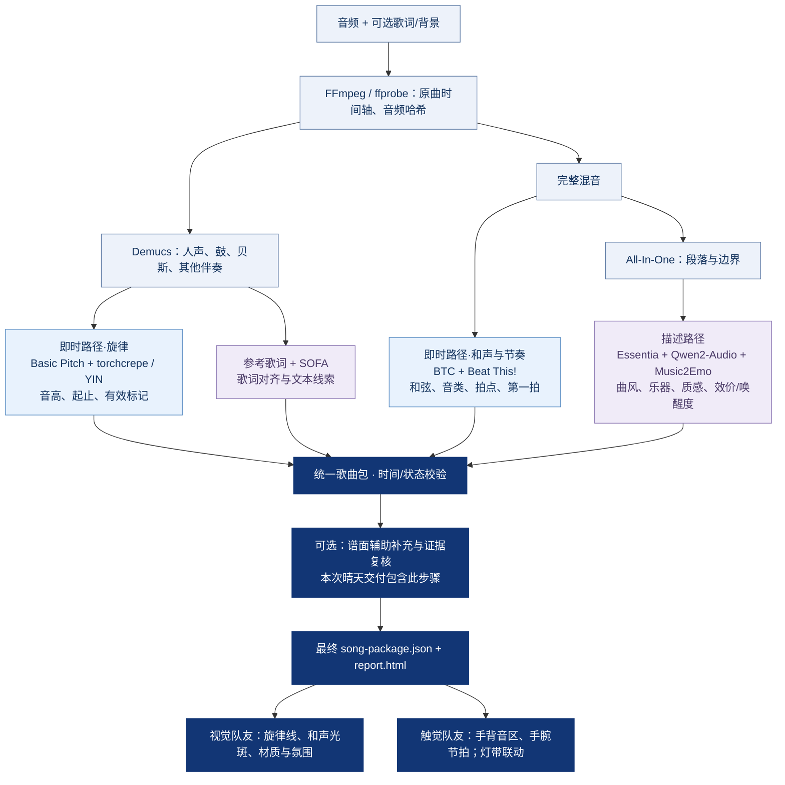
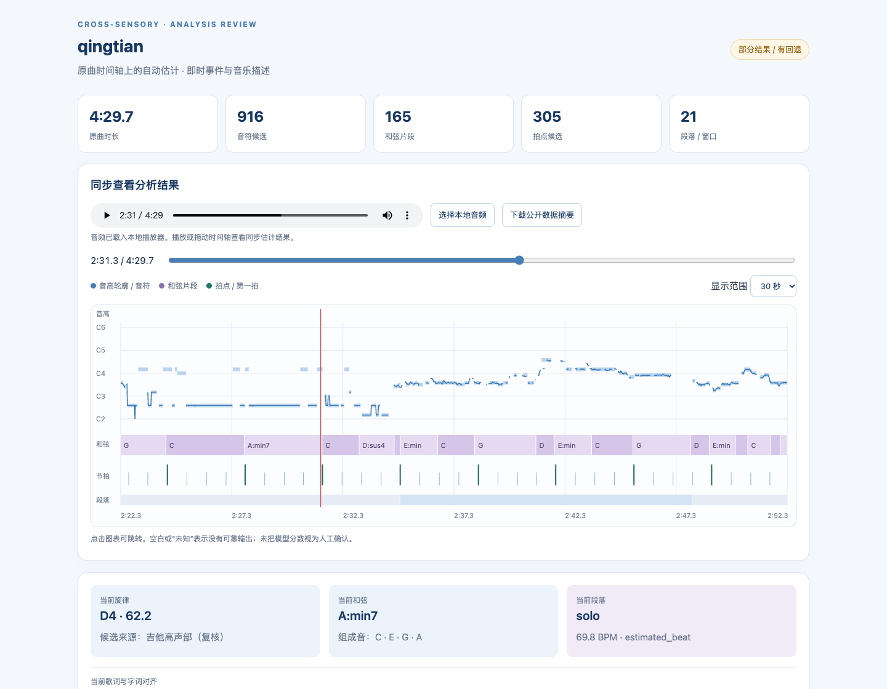

# 跨感官音乐预处理 · 视觉与触觉交接版

**将歌曲分析为同一时间轴上的旋律、和声、节奏和描述数据，供彩色眼镜、手部灯带、固定强度马达读取。**

当前交付：`qingtian-reviewed-2026-11-16`。《晴天》整曲已分析并完成本轮谱面补充和两处冲突复核。你们直接做转译，不用重新安装或运行分析模型

## 队友从这里开始

1. 读 [Framework](docs/framework.md)：目标、信息、通道、映射四层，以及当前硬件边界。
2. 读 [转译接入说明](docs/handoff.md)：每个人读哪些字段、如何同步、需要完成什么。
3. 使用 [最终数据目录](handoff/qingtian/README.md)：`song-package.json` 是下游输入，`report.html` 是回放诊断。
4. 把 [AI 接手指令](docs/ai-prompts.md) 中对应角色的一段交给 AI。

| 交付内容 | 当前结果 |
|---|---|
| 旋律 | 916个音符候选及连续音高 |
| 和声 | 165个和弦片段及组成音类 |
| 节奏 | 305个拍点，其中77个小节第一拍 |
| 描述 | 21个段落/描述区间，曲风、乐器、质感、效价与唤醒度 |
| 歌词 | 本地完整版：50行、494个对齐单位；公开包不含歌词原文 |
| 回放 | 音频同步时间线；本地完整版逐字放大、整句置于下方 |

**这些是分析结果与接入资料，Unity/眼镜画面和 ESP32 马达固件仍由下游实现。** `partial` 保留旋律候选的真实状态，不表示所有分析未完成，也不代表音乐识别已全部验证。

## 整体架构



即时路径的数据也是离线分析后按播放时间读取。SOFA 需要提供歌词，不负责听写；没有背景资料时背景为空。自动基线与后续复核分开记录，重跑模型不会自动复现谱面补充。

## 直接查看

下载仓库后打开 [handoff/qingtian/report.html](handoff/qingtian/report.html)，选择同版本本地音频。音频时长269.747208秒；原文件 SHA-256 见 [manifest.json](handoff/qingtian/manifest.json)。



公开包保留转译所需的数值时间线和音乐标签，不包含原曲、完整歌词、分轨、权重或本地路径。歌词功能请使用另行发送的 `qingtian-team-full.zip`；缺歌词时应显示为空，不用 AI 补写。

## 仓库目录

```text
handoff/qingtian/   当前唯一的公开交付数据、回放页、版本清单
 docs/framework.md 四层设计框架
 docs/handoff.md   视觉、触觉与同步接入说明
 docs/ai-prompts.md AI 接手指令
 docs/             字段格式、安装、方法与实现说明
 src/musicprep/    自动分析、校验、回放与复核代码
 config/           baseline / neural / full 三种运行配置
 scripts/          模型准备与交接导出
 schemas/          JSON Schema
 tests/            自动化测试
 reports/          历史自动基线的实测证据（不是当前交付数据）
```

## 开发与复现

[安装与模型准备](docs/setup.md) · [运行命令](docs/running.md) · [歌曲包字段](docs/package-format.md) · [架构](docs/architecture.md) · [方法](docs/methods.md) · [论文与工具](docs/references.md) · [谱面补充与复核](docs/score-supplement.md)

```sh
# 已配置 Python 环境后：校验公开交接包，不需要模型权重
.venv/bin/musicprep validate handoff/qingtian/song-package.json

# 自动测试
.venv/bin/python -m unittest discover -s tests -v

# 从已有完整结果重新导出公开交接版
.venv/bin/python scripts/export_handoff.py work/qingtian-reviewed/song-package.json \
  --output handoff/qingtian --release qingtian-reviewed-2026-11-16
```

神经模型实测为 Apple M5 / 16GB；Qwen2-Audio 与 SOFA 已接入真实权重。[自动基线实测记录](reports/qingtian-analysis.md) 保留原始耗时与来源；模型运行成功不等于已获得音乐学准确率结论。CI 配置仍为 `config/ci.workflow.example.yml` 模板，尚未启用云端工作流。
