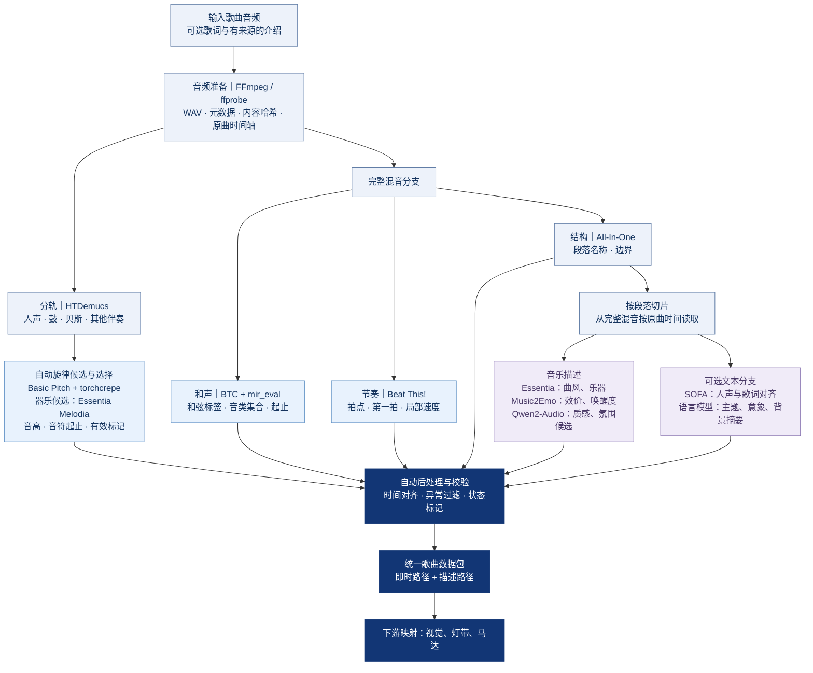

# 跨感官音乐自动预处理

输入歌曲音频，自动生成共享原曲时间轴的旋律、和声、节奏、段落、音乐描述、歌词与背景数据，为视觉、灯带和固定强度马达的映射提供输入。

## 整体架构

以下为完整开发架构：共享音频预处理，自动分析即时事件与音乐描述，统一导出歌曲数据包。



图中省略辅助连线：文本分支同时读取分离人声与可选文本，速度描述复用节奏结果。各模块实现进度见下方说明；[查看详细架构](docs/architecture.md)。

## 开发状态

**当前状态：架构与方法已定义；基础音频准备脚本可运行；音乐模型尚未集成。** 本仓库不把模型候选当作人工确认结果，也不把计划功能标为已实现。生产分析流程不设置逐曲人工审核关卡；开发阶段用标注样本评估准确性。

## 文档入口

| 文档 | 内容 |
|---|---|
| [自动分析架构](docs/architecture.md) | 流程图、依赖、调度、缓存、失败回退 |
| [具体分析方法](docs/methods.md) | 每个目标的输入、模型、输出和算法规则 |
| [数据接口](docs/data-contract.md) | 六份时间线、状态、置信度和映射边界 |
| [开发路线](docs/development-plan.md) | 阶段顺序、交付物、验收条件 |
| [工具与论文](docs/references.md) | 开源项目、文献、模型与环境管理 |
| [晴天测试记录](reports/qingtian-ingest.md) | 实际音频信息、已做与未做的验证 |

## 设计依据

以 [Framework PR #1](https://github.com/AngelaYellow/cross-sensory-live-music/pull/1) 的双路径和映射目标为依据，并纳入后续确认的“全自动分析、无需中途人工操作”要求。

- 即时路径：主旋律音高与起止、和弦组成与更替、拍点与小节信息。
- 描述路径：曲风与速度描述、乐器与音色质感、情绪氛围、歌词与背景。
- 即时路径指呈现随音乐同步；当前分析在播放前离线执行。
- 无法确定的结果显式留空；“没有声音／没有和弦”和“识别失败”分开记录。
- 音区划分、马达脉冲、灯光位置、配色属于下游映射，不写入原始分析结果。
- 初版支持局部彩色近眼窗口；不假设空间定位或全视野 AR 已实现。

## 当前可运行内容

需要 Python 3.10+、FFmpeg 和 ffprobe，无 Python 第三方依赖。

```bash
python3 scripts/prepare_audio.py data/raw/qingtian.flac \
  --track-id qingtian --output-dir work/qingtian
python3 -m unittest discover -s tests -v
```

脚本输出 `canonical.wav` 与 `manifest.json`：保留输入采样率和声道，解码为浮点 PCM，不裁静音、不改变速度、不做响度归一化。各模型的重采样由其适配器执行，并映射回相同秒数。

**以上命令只准备音频，不会生成旋律、和弦或情绪。** 统一 `analyze` 命令将在模型接入后开发。

本地测试已执行。`config/ci.workflow.example.yml` 是待启用的 GitHub Actions 配置示例；当前 GitHub 授权缺少 `workflow` scope，因此本次未启用云端 CI。

## 目录

```text
docs/                  架构、方法、接口、开发计划、来源
config/                待实现的管线配置草案
scripts/               已实现的基础音频准备工具
tests/                 基础处理的验证
reports/               可公开的测试记录；不含音频和完整歌词
data/                  本地测试素材（音频忽略提交）
work/                  本地分析产物与日志（忽略提交）
models/                本地模型权重（忽略提交）
```

后续按模块增加模型适配器与调度器。各模型使用独立环境或独立工作进程，通过文件和 JSON 通信，避免把不同年代的 PyTorch/TensorFlow 依赖强行安装到同一环境。
