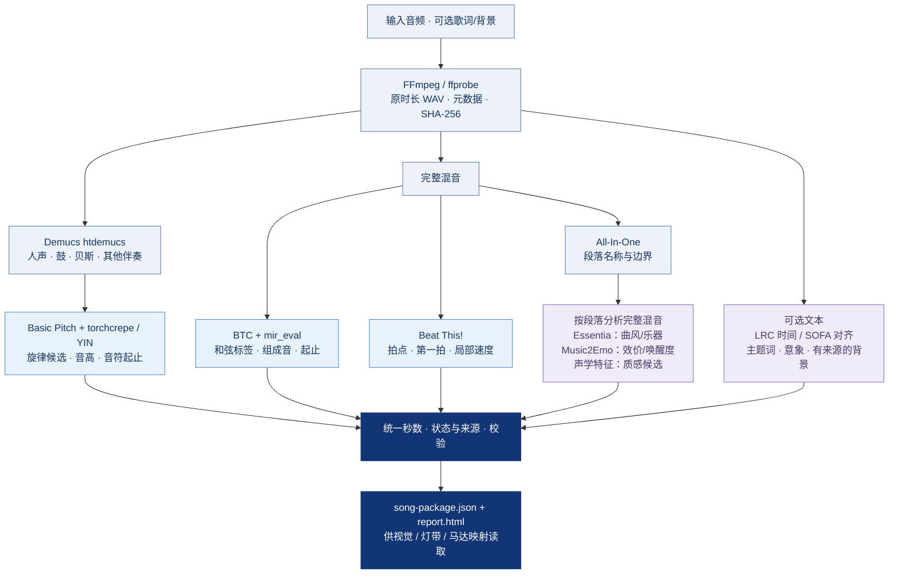

# 跨感官音乐自动预处理

**输入歌曲，一条命令生成旋律、和弦、节拍、段落、音乐描述与可选歌词数据，并用本地报告同步回放。**

分析在播放前离线运行，全程无逐曲人工确认。所有输出保留原曲时间轴，供视觉、灯带和固定强度马达的映射读取。

## 整体架构



缺失模型自动标记并回退；没有歌词或背景时留空。Qwen2-Audio 与 SOFA 是可选适配器，不是默认运行依赖。[详细架构](docs/architecture.md)

## 已实现

| 能力 | 实现 |
|---|---|
| 完整流水线 | CLI、独立任务进程、超时/重试、缓存恢复、运行日志、环境与模型指纹 |
| 即时路径 | Demucs、Basic Pitch + torchcrepe/YIN、BTC、Beat This!、All-In-One |
| 描述路径 | Essentia 曲风/乐器、Music2Emo 效价/唤醒度、声学质感候选 |
| 可选文本 | LRC/纯文本、提取式主题与意象、带来源背景；SOFA 对齐接口 |
| 数据与回放 | JSON Schema + 时间语义校验；离线 HTML 音频播放、拖动和同步时间线 |
| 降级处理 | 基础算法真实计算；实际后端、未知字段与 partial 状态可见 |

已用本地《晴天》整曲和合成音频测试；[实测记录](reports/qingtian-analysis.md)。**链路运行不等于识别准确率达标**：主旋律归属、复杂和弦和描述仍是估计。Qwen2-Audio/SOFA 已有适配代码，本轮未验证其真实权重。

## 快速运行：基础版

需要 Python 3.11、FFmpeg/ffprobe；当前实测 macOS Apple Silicon，基础版也面向 Linux。

```sh
# macOS：brew install ffmpeg uv
uv venv --python 3.11
uv pip install --python .venv/bin/python -e .

# 用自生成声音先试跑，不需要歌曲文件
.venv/bin/python examples/create_demo.py
.venv/bin/musicprep analyze work/demo.wav --output work/demo --profile baseline

# 查看本地报告（macOS）
open work/demo/report.html
```

基础版生成真实算法估计，不提供神经模型的曲风/情绪标签，也不会把窗口名称伪装成主歌/副歌。

## 神经模型版

按 [安装指南](docs/setup.md) 安装模型依赖与准备权重后：

```sh
.venv/bin/musicprep analyze data/raw/qingtian.flac \
  --output work/qingtian-final --track-id qingtian --config config/neural.json

.venv/bin/musicprep validate work/qingtian-final/song-package.json
open work/qingtian-final/report.html
```

可换成任意本地音频；`--lyrics song.lrc --background background.json` 添加可选文本。配置文件中的相对路径以**配置文件目录**为基准。默认配置采用 CPU，适合先验证；首次运行可能下载模型。

- 原命令再次执行会复用有效缓存；改输入、参数、代码、显式模型文件或 worker 环境会自动失效。
- `--force` 强制重新分析。`--require-complete` 让部分完成返回退出码 2。
- `musicprep doctor` 检查环境；`musicprep report package.json --output report.html --audio song.flac` 重建报告。
- 模型缺失或失败保留实际原因；任务配置 `fallback:false` 可禁用降级。

## 回放报告


播放器与原曲时间线同步，支持拖动查看音高、和弦、拍点、段落和描述；全部在本地浏览器运行。

## 输出

```text
work/<歌曲>/
  song-package.json       六份分析时间线、状态与来源
  report.html             无外部依赖的本地回放报告
  run-summary.json        实际配置、环境、耗时
  run-state.json          各任务运行状态
  audio/                  原时间轴 WAV 与 manifest
  cache/                  模型结果、分轨、逐任务日志
```

`complete` 表示所需任务完成，`partial` 表示存在降级、缺失或不确定来源，均不代表已验证音乐正确性。音区划分、马达强弱/脉冲、灯光位置与配色属于下游映射，不混入原始分析结果。

## 文档与开发

[安装与模型准备](docs/setup.md) · [方法](docs/methods.md) · [歌曲包格式](docs/package-format.md) · [数据约定](docs/data-contract.md) · [开发进度](docs/development-plan.md) · [工具与论文](docs/references.md)

```sh
.venv/bin/python -m unittest discover -s tests -v
```

测试覆盖真实子进程的完整基础流程、静音/起音/音高、缓存失效、模型失败、时间边界、LRC 偏移和清屏、非法数据与报告注入。云端 CI 尚未启用；`config/ci.workflow.example.yml` 是可复制的配置示例，现有 GitHub 授权缺少 workflow 写权限。

设计依据：[Framework PR #1](https://github.com/AngelaYellow/cross-sensory-live-music/pull/1)。音频、完整歌词、分离声部和模型权重只保存在本地，不提交公开仓库。第三方代码及权重遵循各自许可，来源与校验值见 [模型清单](config/model-sources.json)。
