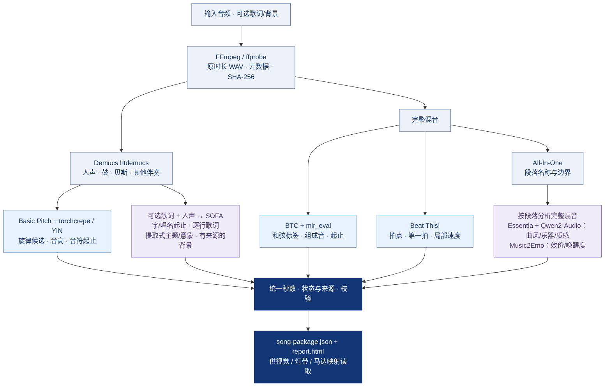

# 自动音乐预处理架构

一份音频进入离线流水线；可选歌词与有来源的介绍。全程不设置逐曲人工确认，导出统一原曲时间轴的歌曲包和本地回放报告。

图省略文本输入辅助线；段落本身也导出。描述读取完整混音；SOFA 读取分离人声和无时间歌词。`full.json` 启用全部模型，Qwen 的输入窗口不超过 30 秒，长段落自动连续切分。

## 实际任务与回退

| 任务 | 实现 | 模型不可用时 |
|---|---|---|
| 音频准备 | 浮点 WAV、保留采样率/声道/首尾静音、不归一化 | 无法解码即终止 |
| separation | Demucs 四轨；不单独归一化声部 | HPSS 谐波/打击成分，明确标 partial |
| rhythm | Beat This!；实际相邻拍点计算速度 | librosa 拍点，小节信息留空 |
| sections | All-In-One 官方分离与特征流程 | 声学变化切分和有界窗口；名称 unknown |
| melody | 人声优先；Basic Pitch 音符与基频相互筛选；长无唱段尝试器乐候选 | YIN + 起音，来源不确定时显式标候选 |
| harmony | BTC 170 类；按真实采样点恢复分块时间 | 大小三和弦模板；不伪造复杂和弦 |
| descriptions | Essentia、Music2Emo、声学质感；可选 Qwen2-Audio | 保留其他模型结果，失败模型单独标记；总任务 partial |
| lyrics_context | LRC 或纯文本；可选 SOFA；提取式文本整理 | 未提供即 skipped；无时间不伪造对齐 |
| 数据交付 | JSON 结构与时序校验、本地 HTML 回放 | 无效包单独保存诊断，不覆盖正常数据包 |

## 调度与恢复

当前顺序：音频准备 → 分轨 → 节拍 → 段落 → 旋律 → 和声 → 描述 → 文本 → 校验与报告。逻辑独立的分析仍按单机资源串行运行；每个任务启动独立进程，描述模型也使用独立工作目录。

- 每任务超时、有限重试、日志、运行状态；失败可继续其他任务。任务级 `timeout_seconds` 可覆盖全局限制；完整配置为描述任务保留 7500 秒，超过内部三个模型超时之和，以便回收已完成片段。模型进程中断时读取原子保存的片段检查点，未完成窗口仍标缺失；整个任务被强制终止时仍标 failed。
- 任务缓存包含输入哈希、代码、参数、实际 Python 环境与显式配置的模型代码/权重哈希；可选文本仅影响文本任务，改报告不触发模型重算。
- 分轨缓存额外校验实际文件哈希；模型失败、缓存损坏或配置变化会重算。
- 已成功的 partial/降级结果也缓存。隐式上游下载缓存中的模型发生变化时用 `--force`；显式配置的权重变化自动失效。
- 同一输出目录用进程锁防止并发覆盖；JSON 原子写入，进程退出自动释放锁。
- `run-state.json` 记录进度；`run-summary.json` 记录实际配置/环境/耗时；`cache/` 保留逐任务日志。

默认缺失模型允许降级；任务配置 `fallback:false` 可要求该任务失败而非回退。CLI `--require-complete` 使 partial 返回退出码 2。`complete` 只说明所需任务完成，不等于音乐识别已正确。

## 分析与呈现的边界

分析输出音乐事件、描述候选和证据，不输出马达 ID、灯带位置或颜色约定。统一时间以原曲开头为 0；分段分析与应用区间分开记录。可选文本只作为数据，不作为程序指令。

曲目效果验证属于开发评估，不成为用户每次使用时的人工操作步骤。没有标注真值时只报告运行和时序诊断，不填写虚构准确率。
