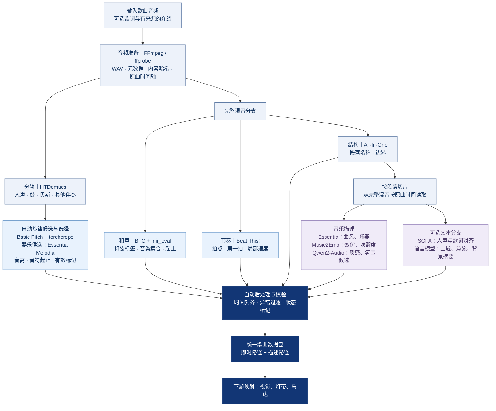

# 自动音乐预处理架构

## 输入与输出

必需输入：一份歌曲音频。可选输入：对应版本歌词、歌曲介绍及来源链接。

输出：共享原曲时间基准的歌曲数据包，包含 `melody`、`harmony`、`rhythm`、`sections`、`descriptions`、`lyrics_context` 六部分及运行报告。

## 主流程

图中省略辅助连线。文本分支同时读取分离人声与可选文本；速度描述复用正式节奏结果。音色和情绪主要分析完整混音，不用纯人声替代整曲声音情境。

## 实际任务依赖

| 任务 | 必需依赖 | 失败时的处理 |
|---|---|---|
| `prepare` | 音频文件 | 输入无法解码则终止，不制造空歌曲包 |
| `separate` | 标准音频 | 重试后失败则标记；可尝试完整混音的显著旋律候选 |
| `melody` | 分离声部；可用时读取完整混音 | 不可靠区间输出 unknown；其他路径继续 |
| `harmony` | 完整混音 | 保留已成功区间，失败区间 unknown |
| `rhythm` | 完整混音 | 拍点失败不使用固定 BPM 伪造；缺第一拍则保留普通拍点 |
| `sections` | 完整混音 | 使用固定长度连续窗口作为描述片段，段落名称 unknown |
| `descriptions` | 完整混音、片段边界 | 单模型失败只置空其字段；速度复用 rhythm |
| `lyrics_context` | 可选文本、分离人声、片段边界 | 缺输入则 skipped；对齐失败可保留整曲语义，不伪造精确时间 |
| `package` | 各任务完成、失败或跳过状态 | 校验成功后原子导出，附部分失败报告 |

All-In-One 自带分离／特征流程。初版保留官方前处理保证兼容；只有验证模型、增益、声部顺序、采样率一致后才能复用分轨缓存，不能把任意四轨直接替换其输入。

## 调度与运行

- `prepare` 完成后，分轨、和声、节奏、结构在逻辑上相互独立。
- GPU 任务默认串行或由资源队列限流，避免“逻辑并行”变成显存竞争。
- Music2Emo 现有代码使用共享临时目录；适配器必须隔离每个任务工作目录，初版逐片段串行调用。
- 每个任务先写临时产物，成功且校验通过后再替换正式结果；失败保留日志。
- 缓存键包含音频 SHA-256、片段范围、模型标识、权重哈希、代码版本、参数和数据版本。任一变化则重新计算相关任务。
- 单任务设置可配置超时与有限重试，不无限等待。恢复运行只重试失败／过期任务。
- 程序生成运行报告，不设置“等待人工审核”状态。

## 自动化边界

音频事件是模型估计；音色与情境是描述候选；视觉材质、颜色、马达脉冲是下游设计约定。模型分析、描述推断和映射策略分别保存。

生产流程无需逐曲人工干预。研发期间需要评估数据和可重复测试，评估结果用于调整全局策略，不把逐曲手工修补变成隐藏的生产步骤。
