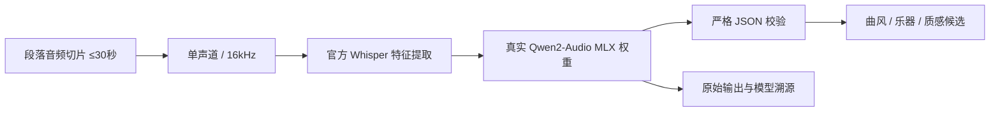

# Qwen2-Audio 本地音频描述

使用真实 **Qwen2-Audio-7B-Instruct 的 MLX 4-bit 转换权重**，在 Apple Silicon 上运行。它补充曲风、乐器与音色质感候选，不覆盖 Essentia 标签，不产生效价/唤醒度数值，也不根据歌曲名猜测内容。

## 模型与环境

| 项目 | 固定值 |
|---|---|
| 原始模型 | `Qwen/Qwen2-Audio-7B-Instruct` |
| 转换权重 | `mlx-community/Qwen2-Audio-7B-Instruct-4bit` |
| 权重 revision | `c65570002626f41b4dc08b7b54f42f99f3e82e7f` |
| 权重文件 | `weights.safetensors`，6,562,540,479 字节 |
| SHA-256 | `0967cde270ad62aa4824f0bbce283d0a2a6da2825ccf587640753c527d4174da` |
| 量化 | 语言模型线性层 4-bit，group size 64；词嵌入、音频编码器及投影层保持 BF16 |
| mlx-audio | `0.6.5`，Git revision `b5fcbe964b9e4cad4b06782f97d3e51fe74a8702` |
| 独立运行环境 | Python 3.11、MLX 0.32.4、Transformers 5.23.0 |

直接下载量化权重，不下载 15 GB 原始权重再转换。独立 `.venv-qwen` 不改变主项目 Torch / Transformers 环境。模型卡文案中的约 4.2 GB 与实际文件大小不一致，容量预算按实际 6.56 GB 计算。

从项目根目录安装，脚本固定模型 revision、主要依赖版本，并在下载后验证完整文件大小与 SHA-256：

```sh
python3 scripts/setup_qwen.py
```

已安装环境时可加 `--skip-install`；只准备环境时可加 `--skip-download`。下载可续传，默认关闭 Xet 磁盘 chunk cache，避免大模型产生另一份缓存。原始 BF16 权重不会下载。

权重由项目模型安装流程下载到 `models/qwen2-audio-mlx-4bit`。适配器离线加载本地文件，启动时校验 SHA-256；没有缺失模型的伪结果。

## 数据流程



每段独立输入，温度为 0；默认最多生成 256 tokens。超过 30 秒的片段直接报错，由上游先切分，避免模型静默截断。静音输出三个空数组并标记 `silent_audio`，不计为模型生成。允许移除完整 JSON 代码围栏、解包一层合法 JSON 字符串，或对完整对象解除一次统一的引号转义；含嵌套引号歧义或对象外自由文本时拒绝修复。原文与规范化方式写入 audit。无效 JSON 自动重试一次，仍失败则保留错误，不从自由描述里编造结构化标签。

返回格式：

```json
{
  "genre": ["pop"],
  "instruments": ["guitar", "male singing voice"],
  "textures": ["bright", "layered"]
}
```

以上只是格式示例，不是歌曲实测结果。模型产生的标签始终属于未经人工验证的候选，不能当作乐器存在概率或精确编曲事实。

## MLX 音频前端修正

所固定的上游 MLX 实现采用手写 HTK mel 滤波器、固定 750 个音频 tokens，并未给编码器加入有效长度的 padding key mask。官方 Hugging Face Qwen2-Audio 使用 Whisper 特征和按实际长度计算的 mask/tokens。

本适配器保留原权重，在调用范围内完成以下修正：

1. 采用模型配置中的官方 `WhisperFeatureExtractor`，使用 Slaney mel 特征。
2. 按真实帧数计算卷积与池化后的音频 token 数，例如 8 秒是 200 个，30 秒是 750 个。
3. 在编码器注意力中屏蔽 padding key，避免补齐区域影响有效音频表示。
4. 投影特征保持浮点类型。当前权重词嵌入实际为 BF16；不把潜在的 packed uint32 权重类型作为特征类型。

这些变更不是另一套音频模型，也没有改写权重；但与上游未经修正的 MLX 运行结果可能不同。当前验证覆盖前端语义和真实推理链路，不宣称与全精度 Hugging Face 模型逐元素一致。

## 集成接口

```python
from musicprep.adapters.qwen import make_predictor

predict = make_predictor({
    "runtime": "mlx",
    "model_id": "/absolute/path/models/qwen2-audio-mlx-4bit",
    "max_new_tokens": 256,
    "prefill_step_size": 256
}, root="/absolute/path/work/task")
labels = predict("/absolute/path/clip.wav")
```

`predict.provenance` 保存权重哈希、量化配置、软件版本、prompt 与实际前端。`predict.audit` 及 `work/task/qwen-audit/*.json` 保存每次尝试的原始回答、解析错误、耗时和 MLX 进程内存峰值。业务输出只接受 `genre / instruments / textures`，出现 `emotion` 等额外键会触发格式错误。

16 GB 机器顺序运行片段，共用一次模型加载；不建议同时运行其他大模型。Metal cache 默认限制为 256 MB，片段结束清理缓存。该限制只限制缓存，不是整个模型内存上限。

## 验证范围

十项自动测试覆盖 JSON 解析、禁止自由文本转标签、禁止情绪字段、多 JSON 歧义、实际时长/token 数、拒绝长片段、拒绝自定义权重冒用固定模型身份、已有权重时补齐 tokenizer 且不重下大文件、真实模型引号转义回归与模糊引号拒绝，以及修改 padding 区域不改变有效音频特征的数值测试。主环境跳过需要 MLX 的数值测试；在 `.venv-qwen` 中执行全部测试：

```sh
PYTHONPATH=src .venv-qwen/bin/python -m unittest discover -s tests -p test_qwen.py -v
```

## 真实权重验证

2026-11-16，Apple M5 / 16 GB 上，以《晴天》真实 8 秒片段验证：

| 项目 | 实测 |
|---|---|
| 实际设备 | `Device(gpu, 0)`（MLX / Metal） |
| 结果计数 | generated 1；silent_audio 0；failed 0 |
| 生成长度 | 50 tokens |
| 单片推理 | 3.14 秒 |
| MLX 进程内存峰值 | 7,037,668,082 字节，约 6.55 GiB |
| JSON 处理 | 完整对象的一次引号转义规范化；保留原文 |

候选输出为 `rock / indie rock`、`electric guitar / acoustic guitar / drums / bass`、`grainy / dusty`。这是该模型对该片段的原始分类候选，不是已核实的音乐学结论；模型可能漏检人声、误判乐器或曲风。随后已通过完整主流水线验证《晴天》21 个窗口：21 个窗口生成成功，0 个静音跳过，0 个失败/拒绝/缺失窗口；包含自动重试，共 33 次生成尝试。全曲指标见 [整曲验证报告](../reports/qingtian-analysis.md)。

本地审计：`work/qwen-real-full/smoke-result.json`。权重完整 SHA-256 已核验；下载路径为固定 revision 的 Hugging Face 前缀与镜像 Range 补齐，诊断保存在模型目录 `download-diagnostics.json`。权重未修改。

## 方法来源

[Qwen2-Audio 原始模型](https://huggingface.co/Qwen/Qwen2-Audio-7B-Instruct) · [技术报告](https://arxiv.org/abs/2407.10759) · [MLX 转换权重](https://huggingface.co/mlx-community/Qwen2-Audio-7B-Instruct-4bit/tree/c65570002626f41b4dc08b7b54f42f99f3e82e7f) · [MLX Audio 实现](https://github.com/Blaizzy/mlx-audio/blob/b5fcbe964b9e4cad4b06782f97d3e51fe74a8702/mlx_audio/stt/models/qwen2_audio/qwen2_audio.py) · [Hugging Face 参考实现](https://github.com/huggingface/transformers/blob/v4.57.6/src/transformers/models/qwen2_audio/modeling_qwen2_audio.py)
