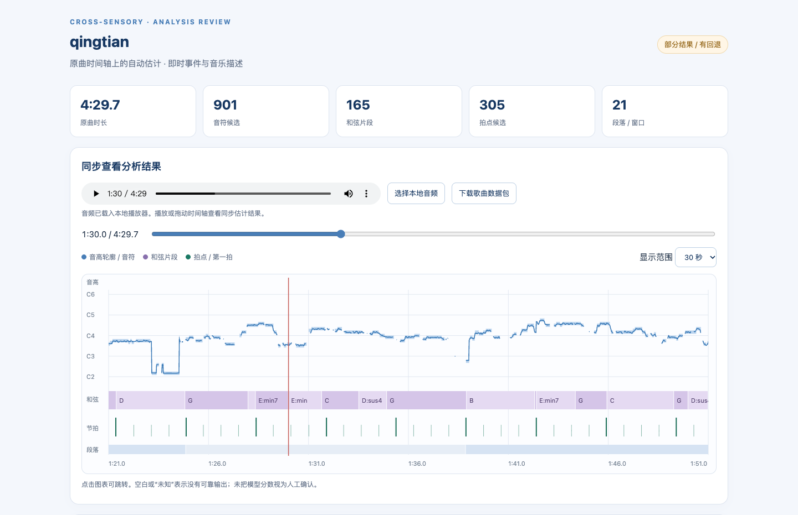

# 《晴天》整曲自动分析实测

日期：2026-11-16。输入为用户本地 FLAC，时长 **269.747208 秒**、96 kHz、双声道。原曲及分轨未上传。

配置：`config/neural.json`。设备：Apple M5 / 16 GB / CPU / Python 3.11。流程无需处理中人工干预；音乐结果未手工修订。

## 运行结果

| 任务 | 实际后端 | 状态 | 本轮耗时（秒） |
|---|---|---|---:|
| separation | demucs | succeeded | 83.33 |
| rhythm | beat_this | succeeded | 9.45 |
| sections | allin1 | succeeded | 377.75 |
| melody | basic-pitch+torchcrepe | partial | 37.35 |
| harmony | BTC-ISMIR19 | succeeded | 2.75 |
| descriptions | scipy_acoustic_features+essentia+music2emo | partial | 42.17 |
| lyrics_context | supplied_text_extractive | skipped | 0.04 |

任务执行合计 **552.84 秒**，不含安装环境、前置模型下载、音频准备与报告写入；All-In-One 本轮包含剩余权重下载及其官方独立分离。不是纯推理性能基准，亦不是实时处理承诺。

| 输出 | 数量 |
|---|---:|
| 旋律音符候选 | 901 |
| 和弦片段 | 165 |
| 拍点 / 第一拍 | 305 / 77 |
| 结构段落 / 描述区间 | 21 / 21 |
| 有曲风候选的区间 | 19 |
| 有乐器 / 效价唤醒度的区间 | 21 / 21 |

整包状态为 **partial**：长无唱段使用周期性器乐候选，无法保证其属于主奏；首尾两段曲风分数未达到配置阈值，保持空值。全部七项任务无 failed；未提供歌词和背景，因此文本路径 skipped。情绪输出采用模型原生 1–9 量表，不解释成用户感受。

## 实际模型

- Demucs `htdemucs` 四轨；不做声部独立峰值归一化。
- Basic Pitch ONNX + torchcrepe `tiny`，器乐候选路由另保留来源。
- BTC 170 类，真实采样点偏移修正分块时间；`N` 与 `X` 分别为无和弦和未知。
- Beat This! `final0`，未填写无依据的记谱拍号。
- All-In-One `harmonix-all` 八折集成，固定 HF revision，8 份权重哈希见 JSON。
- Essentia EffNet + Discogs400 + MTG Jamendo instrument；Music2Emo `J_all` + MERT-v1-95M。

## 自动识别的结构

以下仅为模型估计，未经音乐学标注核验；相同标签的相邻片段保留原边界。

| 原曲秒数 | 模型标签 |
|---|---|
| 0.00–0.85 | start |
| 0.85–14.81 | intro |
| 14.81–28.83 | intro |
| 28.83–42.83 | verse |
| 42.83–56.84 | verse |
| 56.84–69.98 | verse |
| 69.98–84.87 | verse |
| 84.87–98.87 | chorus |
| 98.87–112.91 | chorus |
| 112.91–126.89 | chorus |
| 126.89–140.91 | bridge |
| 140.91–154.90 | solo |
| 154.90–168.05 | verse |
| 168.05–182.91 | verse |
| 182.91–196.94 | chorus |
| 196.94–210.97 | chorus |
| 210.97–224.94 | chorus |
| 224.94–238.96 | chorus |
| 238.96–252.95 | chorus |
| 252.95–266.32 | chorus |
| 266.32–269.75 | end |

## 工程验证与限制

歌曲包通过结构与时间语义校验；原曲时间范围、事件排序、和弦连续覆盖、有限数值和未知状态检查通过。共 67 项自动测试覆盖基础流程、模型接口、缓存/失败、LRC 时间、数据约束与报告安全；真实神经权重另用本曲集成运行验证。

复跑七个任务全部命中缓存。浏览器验证：音频时长匹配、90 秒定位、播放游标、图上点击跳转、手机布局均通过，无 JavaScript 异常及外部网络请求。

没有标注真值，因此**不提供旋律、和弦、节拍、段落或情绪的准确率**。单曲运行不能证明泛化；Qwen2-Audio 与 SOFA 真实权重未验收。Music2Emo 上游的已知调式处理限制见 [模块说明](../docs/descriptions-implementation.md)。

[运行指标 JSON](qingtian-analysis.json) · [安装与复现](../docs/setup.md)
